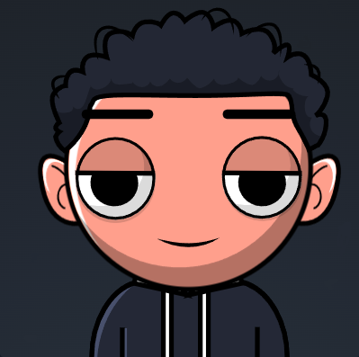

### Olá!

Sou Gabriel, **desenvolvedor front-end**.

Trabalho principalmente com React.js, Next.js e TypeScript. Tenho interesse em arquitetura de front-end, performance e organização de código. Também gosto de trabalhar próximo ao back-end na definição de contratos de dados e transformar designs do Figma em interfaces funcionais.

No tempo livre, desenvolvo projetos pessoais para testar ideias, explorar abordagens técnicas e aprender novas tecnologias.

[`📬 gabriel.rslima10@gmail.com`](mailto:gabriel.rslima10@gmail.com)
[`💼 LinkedIn`](https://www.linkedin.com/in/gabriel-lima-860612236)

### 🧑🏽‍💻 Habilidades

Atuo principalmente com **JavaScript** e **TypeScript**, utilizando **React.js**, **Next.js** e **React Native**. Tenho experiência com **Node.js**, especialmente na integração com APIs, além de trabalhar com **Docker** e **Figma**. Também possuo conhecimentos em **testes unitários** (RTL, Jest e Vitest).

### 🔥 Projetos Significativos
Meus principais projetos de código aberto estão nos **repositórios fixados**. Além deles, desenvolvi a seguinte entrega comercial com repositório privado disponível no ar:

* [**downcars:**](https://oficinadowncars.netlify.app/) Página institucional desenvolvida para uma oficina mecânica, estruturada para apresentar os serviços prestados, transmitir credibilidade e facilitar o contato direto com os clientes.

